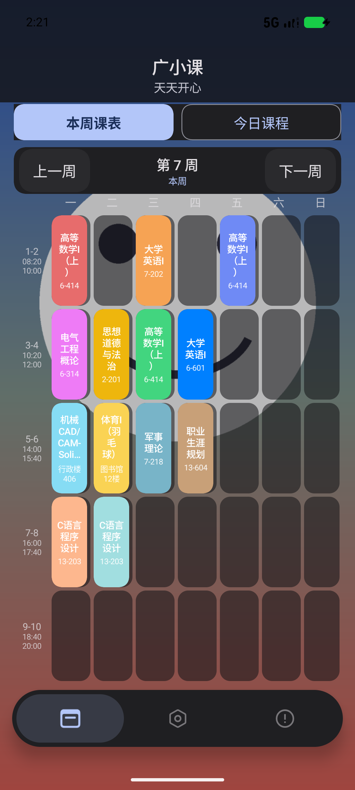
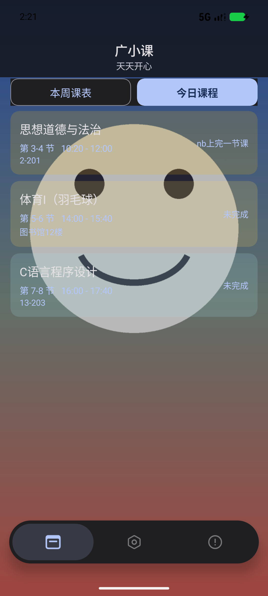
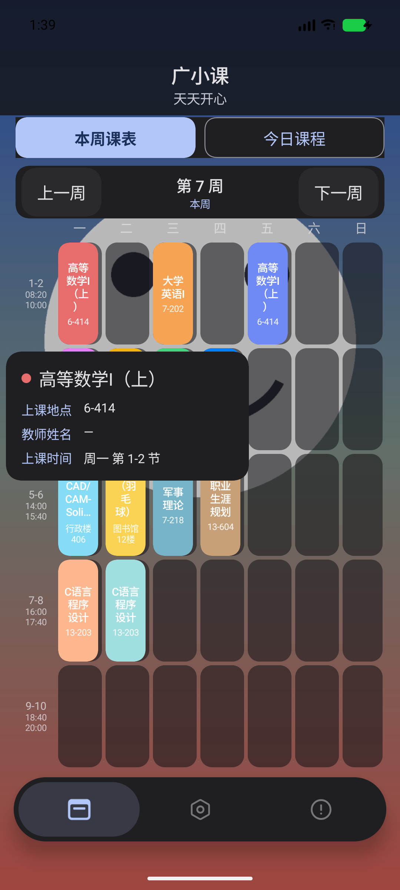
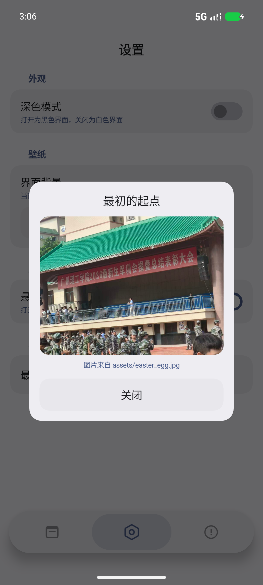

# 广小课

广州理工学院（GZIST）学生用的原生 Android 课表 App。
登录学校统一身份认证后自动导入整学期课表，1~2 秒完成。

<p align="center">
  
  
  
  
</p>

## 功能

- **课表导入**：登录统一身份认证后直连接口拉取整学期课表（1~2 秒）；接口数据须通过双向校验，不通过则自动回退逐周页面解析
- **周课表 / 今日课程**：左右滑动或按钮切周，带弹性过渡动画
- **今日进度**：按当前时间标注每门课是否上完（nb上完一节课 / nb又上完一节课 / 未完成），全部上完会提示「已完成今日所有课程」
- **课程详情**：点课程在手指附近弹出浮层（课程名 / 地点 / 教师 / 时间），再点同一位置收起
- **悬浮 Dock 栏**：胶囊式 Dock，点按带滑动指示器动画，可在设置里切回贴边状态栏
- **外观**：深色模式、自定义背景（可拖动、缩放调整构图）、恢复默认
- **彩蛋**：设置页「最初的起点」

## 环境要求

| 项目 | 版本 |
| --- | --- |
| minSdk | 30（Android 11） |
| targetSdk / compileSdk | 37 |
| Kotlin | 2.4.21 |
| AGP | 9.4.1（内置 Kotlin，无需再应用 kotlin-android 插件） |
| Gradle | 9.8.1 |
| UI 组件库 | Miuix by YuKongA |

## 构建

```bash
# 调试版
./gradlew :app:assembleDebug

# 单元测试
./gradlew :app:testDebugUnitTest

# 正式版（需要签名配置，见下）
./gradlew :app:assembleRelease
```

正式版签名读取根目录的 `keystore.properties`（该文件与 keystore 均**未提交**）：

```properties
storeFile=keystore/guangxiaoke.jks
storePassword=你的密码
keyAlias=guangxiaoke
keyPassword=你的密码
```

没有这个文件时 release 会退化成未签名包，不影响 debug 构建。

## 项目结构

```
app/src/main/java/com/jianke/schedule/
├── data/
│   ├── ZfsoftParser.kt      正方教务接口（kbList）解析
│   ├── ApiValidator.kt      接口数据与页面数据的双向校验
│   ├── MobileDomParser.kt   手机版课表页 DOM 解析
│   ├── ScheduleStore.kt     课表本地存储
│   ├── CourseColors.kt      课程配色
│   ├── ClassTimes.kt        作息时间
│   ├── Prefs.kt             设置存储
│   ├── Wallpaper.kt         自定义背景
│   └── EasterEgg.kt         彩蛋图片加载
├── web/
│   ├── SchoolEndpoints.kt   学校各系统地址
│   ├── ScheduleJs.kt        页面解析与翻周注入脚本
│   └── ApiProbeJs.kt        接口探测脚本
└── ui/
    ├── AppRoot.kt           主题 / 壁纸 / 底栏 / 导航
    ├── HomeScreen.kt        周课表、今日课程、课程浮层
    ├── ImportScreen.kt      导入流程（接口优先，页面兜底）
    ├── SettingsScreen.kt    设置
    ├── FloatingDock.kt      悬浮 Dock 栏
    ├── WallpaperEditor.kt   背景构图调整
    ├── AboutScreen.kt       关于与鸣谢
    ├── EasterEggDialog.kt   彩蛋弹窗
    └── PrivacyDialog.kt     首次启动提示
```

## 数据与隐私

- 课表、设置、壁纸**只保存在本机** App 私有目录，不联网上传
- 导入时通过 WebView 登录学校系统，账号密码不经过本 App，也不做任何存储

## 鸣谢

| 名字 | 贡献 |
| --- | --- |
| DeepSeek Harness | 开发与调试环境 |
| YuKongA | Miuix 界面组件库 |
| 薪音 | 测试 |
| curian | 测试 |
| xxl | 测试 |
| xfankang | 作者 |

## 更新日志

见 [CHANGELOG.md](CHANGELOG.md)。
